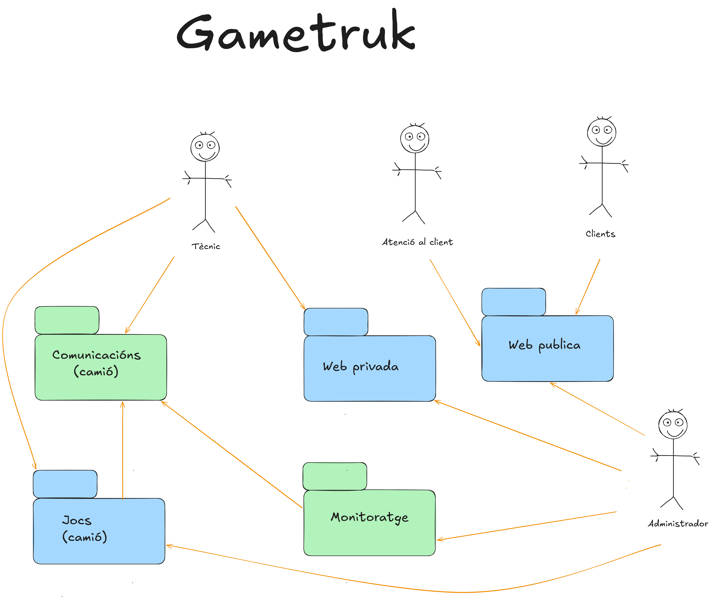

<h1> Descripció del sistema </h1>

El nostre projecte es diu GameTruk. Consisteix en una petita empresa dedicada en l'entreteniment i de videojocs. L'empresa disposa de diversos camions adaptats a l'espai gaming, on els clients podran jugar amb els seus amics

Cada camió te dos treballadors: un tècnic, encarregat de comprovar i mantenit que tota la infraestructura funcioni correctament, i una persona d'atenció al client.

Cada camió te connexió a internet a traves de antenes Starlink.
El projecte també te un administrador que treballa de manera remota i que s'encarregà de supervisar tots els camions.

<h1>Composició del sistema</h1>

<ul>
     <li>Comunicacións ( per camió): S'encarrega de donar connexió a internet i permet la comunicació entre els dispositius de cada camió</li>
     <li>Jocs (per camió): Conjunt d'equips i programes que permeten als clients jugar</li>
     <li>Web privada: Sistema intern que permet als tècnics comunicar incidències (per camió) a l'administrador</li>
     <li>Web Publica: Pàgina web per als clients i l'encarregat per veure la informació i l'encarregat podra veure les reserves que s'han fet</li>
     <li> Monitoratge: Sistema que permet a l'admin supervisar l'estat de diferents camions</li>
</ul>

<h1>Estructura del sistema</h1>

Els components estan connectats entre si per el funcionament del projecte.
En cada camió que tindrem en disposició tindrà la seva propia infrestructura de comunicacions i també els dels jocs.
Tindrem StarLinks per la xarxa i les combinarem en una sola per facilitar l'us i tenir una bona comunicació amb l'administrador.

<h1>Entorn del sistema</h1>

<ul> 
    <li>Tècnic: Comprova que funciona la infraestructura de cada camió i comunica les incidències a l'admin</li>
    <li>Treballador d'atenció al client: Ajuda els clients durant el servei</li>
    <li>Administardor remot: Supervisa tots el camions, rep les incidències i gestiona els problemes</li>
    <li>Clients: Utilizen els serveis gaming i consulten la informació en la web publica</li>
</ul>

